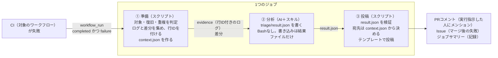

# 設計

状態：たたき台。未検証。要検証の項目は、「TBD」と書く。PoCなので、軽く保つ。

## 1. 構成③の全体像
1つのジョブの中で、3つの段階に分ける。スクリプトとスキルは、デフォルトブランチのもの。



## 2. 構成①②③の違い
| 項目 | ① 短い指示＋ツール許可 | ② 丁寧なプロンプトのみ | ③ ハーネス |
|---|---|---|---|
| ログの取得 | AIが`gh`で取得 | AIが`gh`で取得 | 準備のスクリプトが取得し、行IDを付ける |
| 要件の伝え方 | 「PRにコメントして」程度 | 8つの要件を、文章で伝える | スキルとスクリプト |
| 投稿 | AIが`gh`で投稿 | AIが`gh`で投稿 | AIの外の投稿スクリプト |
| AIのツール | `Bash(gh *)` | `Bash(gh *)` | 結果ファイルの書き込みと、証拠の読み取りだけ。Bashなし（TBD） |
| 入口の制約 | 同じ（失敗した実行、同じリポジトリ、有効な構成） | 同じ | 同じ |
| ジョブの権限 | 同じ（`actions: read`、`contents: read`、`pull-requests: write`、`issues: write`） | 同じ | 同じ |
| モデル | 同じ（TBD：モデルIDの指定） | 同じ | 同じ |

## 3. 準備の状態と、投稿の決定
準備のスクリプトが、状態を決める。定型の投稿をするのは、`post_target`の実行だけ。

| state | 意味 | AI | 投稿 |
|---|---|---|---|
| `out_of_scope` | 対象外または判定不能（fork、bot、cron、手動、PR特定不能） | 呼ばない | なし（ジョブサマリーのみ） |
| `record_only` | 対象だが、投稿しない（復旧済み、処理済み、監視対象外、重複で追記不要） | 呼ばない | なし（ジョブサマリーのみ） |
| `post_target` | 投稿する | 呼ぶ | 通常は、AIの結果で投稿。結果がない、または検証に失敗したら、定型の投稿 |
| `analysis_failed` | `post_target`だが、AIの結果が得られなかった | 呼んだが失敗 | 定型の「調査失敗」を投稿 |

投稿先の決定（`post_target`の実行）：

| route | 条件 | 書き込み |
|---|---|---|
| `pr` | 同じ元のrun IDとattemptのマーカーがある | なし |
| `pr` | 同じPRに、このrunの前のattemptのコメントがある | 既存のコメントを更新 |
| `pr` | 上記以外 | PRにコメントを作成 |
| `merge` | 監視対象、未復旧、同じフィンガープリントのopenなIssueなし | Issueを作成 |
| `merge` | 同じフィンガープリントのopenなIssueあり、かつ、同じ元のrun IDとattemptのマーカーなし | 既存のIssueに追記 |
| `merge` | 同じ元のrun IDとattemptのマーカーがある | なし |

投稿の直前に、対象、復旧、処理済みを、もう一度確認する。

## 4. データの形式
| 名前 | 場所 | 内容 |
|---|---|---|
| 証拠 | `evidence/log.txt`、`evidence/diff.patch` | ログは、1行ごとに、行ID（`L<番号>`）を付ける。失敗したステップの周辺に絞る |
| 実行情報 | `triage/context.json`（`schemas/context.schema.json`） | 宛先と事実。AIは書き換えない（設計上） |
| 結果 | `triage/result.json`（`schemas/result.schema.json`） | AIが書く。`category`、`summary`、`suspected_cause`、`evidence`、`next_steps` |
| マーカー | コメントとIssueの本文の先頭 | `<!-- triage:run-<run_id>-attempt-<n> -->`。重複の判定に使う |

## 5. 投稿スクリプトの検証
| 検証 | 内容 | 要件 |
|---|---|---|
| スキーマ | `result.json`を、`result.schema.json`で検証する | S-04 |
| 行IDの存在 | `evidence`の行IDが、元のログにある。引用は、スクリプトが、元のログから組み立てる | R-11 |
| ネットワークエラー | `category`が`network_error`のとき、`evidence`の行が、典型的なメッセージ（例：`i/o timeout`、`connection reset`、`TLS handshake timeout`）を含む。含まなければ、「不明」として投稿 | S-05 |
| 無害化 | `@`、リンク、画像、HTMLを除去する。文字数の上限 | S-04 |
| 宛先 | `context.json`から決める。`result.json`の内容では、変えない | S-03 |
| ハッシュ | 守る対象のハッシュを照合する（検知） | S-07 |
| 再確認 | 投稿の直前に、対象、復旧、処理済みを、もう一度確認する | R-14 |

## 6. フィンガープリント
Issueの重複の判定に使う近似。「同じ原因」の識別ではない。

- 材料：ワークフロー名、job名（matrix条件を含む）、失敗したステップ名、正規化した最初のエラー行
- 正規化：時刻、UUID、絶対パス、数値の並びを、置き換える
- 計算：材料を連結して、SHA-256
- 弱点：名前の変更、最初のエラー行が後続の症状であること、正規化のしすぎ、エラー行を取れない場合

## 7. テンプレート（投稿の文面）
AIの出力は、テンプレートに当てはめる。AIは、枠を変えられない。

```markdown
<!-- triage:run-<run_id>-attempt-<n> -->
## CI失敗の調査結果（自動）

- 対象：`<workflow>`ワークフロー（run #<run_id>、attempt <n>、コミット`<sha7>`）
- 要約：<summary>
- 原因の仮説：<suspected_cause>
- 根拠：<引用。スクリプトが、行IDから組み立てる>
- 次の対応：<next_steps>

※ AIによる推測です。原因を断定するものではありません。
<mention>
```

Issueは、見出しを「mainのCIが失敗しています（自動）」にする。同じ失敗の再発は、コメントで追記する。

## 8. 権限と許可
| ステップ | ジョブの権限 | 備考 |
|---|---|---|
| 準備 | `actions: read`、`contents: read` | ログの取得と、実行履歴の取得 |
| 分析（AI） | 同じジョブの権限（`pull-requests: write`、`issues: write`を含む） | トークンは、AIの環境にある（公式の記述）。AIには、Bashも、書き込みのツールもない（TBD：許可の書き方） |
| 投稿 | `pull-requests: write`、`issues: write` | 通常のステップ |

AIに許可するツール（案、TBD）：証拠ファイルの読み取り、`triage/result.json`の書き込み。Bash、Webの取得は、denyで明示する。

## 9. 要検証（TBD）
スパイクで、確認する。結果は、`docs/decisions.md`に記録する。

| 項目 | 確認すること |
|---|---|
| 許可の書き方 | 結果ファイルだけを書けるようにする規則（`Edit`の規則は、書き込みを行うすべての組み込みツールに効く）。Bashを使えないこと |
| 読み取り範囲 | `Read`を証拠に限定する規則（denyはallowの例外を作れない） |
| スキルの`allowed-tools` | 許可（付与）か、制限か |
| 権限モード | `default`、`acceptEdits`、`dontAsk`の違いと、Actionでの既定 |
| トークンの露出 | `GITHUB_TOKEN`と`GH_TOKEN`が、AIの環境にあるか |
| モデルの指定 | `--model`に、モデルIDを指定できるか |
| スキルの読み込み | `workflow_run`の既定のチェックアウト（デフォルトブランチ）に置いたスキルを、読めるか |
| 完全性の確認 | 期待するハッシュの保存場所、照合するコード、AIが変更できる場所。独立して守れない場合は、投稿を別のジョブに分ける設計（案A）に戻す |
| `workflow_run`のペイロード | `pull_requests`、`head_repository`、`run_attempt`、`triggering_actor`の取得 |
| 直接pushとマージ後のpush | コミットに紐づくマージ済みPRで、区別できるか |

## 10. 実装の方針（PoC）
- 準備と投稿のスクリプトは、bashと`jq`と`gh`。理由：ランナーに標準で入っている。軽く始める（`docs/decisions.md`のD-04）
- 置き場所：`.claude/skills/ci-failure-triage/`（`SKILL.md`、`references/`、`scripts/`）
- テスト：`gh`を、呼び出しを記録するスタブに置き換えて、固定のログとJSONで確認する（`tests/`）
- スキーマの検証：`scripts/validate_schemas.py`
