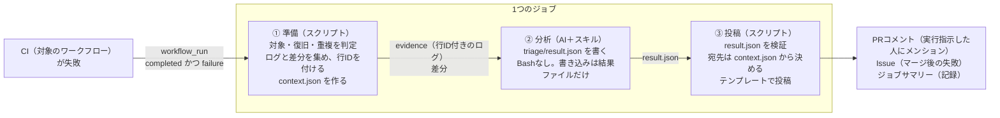

# 設計

状態：たたき台。未検証。要検証の項目は、「TBD」と書く。PoCなので、軽く保つ。

## 1. 構成③の全体像
1つのジョブの中で、3つの段階に分ける。スクリプトとスキルは、デフォルトブランチのもの。



## 2. 構成①②③の違い
| 項目 | ① 短い指示＋ツール許可 | ② 丁寧なプロンプトのみ | ③ ハーネス |
|---|---|---|---|
| ログの取得 | AIが`gh`で取得 | AIが`gh`で取得 | 準備のスクリプトが取得し、行IDを付ける |
| 要件の伝え方 | 「PRにコメントして」程度 | 8つの要件を、文章で伝える | スキルとスクリプト |
| 投稿 | AIが`gh`で投稿 | AIが`gh`で投稿 | AIの外の投稿スクリプト |
| AIのツール | `Bash(gh *)` | `Bash(gh *)` | 結果ファイルの書き込みと、証拠の読み取りだけ。Bashなし（TBD） |
| 入口の判定 | 同じ（共通の`gate.sh`。第2.1節） | 同じ | 同じ |
| 業務要件の情報 | 短い一文で、宛先、対象attempt、更新・新規・抑制の要点（D-11） | 条件を明記 | スクリプトとスキル |
| ジョブの権限 | 同じ（`actions: read`、`contents: read`、`pull-requests: write`、`issues: write`） | 同じ | 同じ |
| モデル | 同じ（TBD：モデルIDの指定） | 同じ | 同じ |

## 2.1 入口の判定（3構成共通。D-10）
Claudeを起動する前に、共通のスクリプト（`scripts/gate.sh`、bash＋`jq`＋`gh`）が判定する。比較の条件から外し、固定する。

| 判定 | 内容 | 判定できないとき |
|---|---|---|
| 元のイベント | `pull_request`、または、デフォルトブランチへの`push` | 対象外 |
| リポジトリ | 元のrunの`head_repository`が、同じリポジトリ（forkを除外） | 対象外 |
| PR | `pull_requests`から対象のPRを決める。PRの作成者がbotなら対象外 | 対象外 |
| mainのpush | コミットに紐づくマージ済みPRがあれば`merge`。なければ（直接push）、対象外 | 対象外 |
| 実行指示した人 | 初回は`actor`、再実行は`triggering_actor`。PRの作成者とは別に扱う。取れない、またはbotのときは、`mention: null`（メンションなし） | `null` |

出力は、`triage/context.json`（`route`、`state`）。`out_of_scope`のときは、AIを呼ばず、投稿しない。3つのワークフローは、この判定の結果の`state`が`post_target`のときだけ、Claudeのステップを実行する。

## 3. 準備の状態と、投稿の決定
準備のスクリプトが、状態を決める。定型の投稿をするのは、`post_target`の実行だけ。

| state | 意味 | AI | 投稿 |
|---|---|---|---|
| `out_of_scope` | 対象外または判定不能（fork、bot、cron、手動、PR特定不能、直接push）。`gate.sh`は、`record_only`を決めない（D-14） | 呼ばない | なし（ジョブサマリーのみ） |
| `record_only` | 対象だが、投稿しない（復旧済み、処理済み、監視対象外、重複で追記不要） | 呼ばない | なし（ジョブサマリーのみ） |
| `post_target` | 投稿する | 呼ぶ | 通常は、AIの結果で投稿。結果がない、または検証に失敗したら、定型の「調査失敗」を投稿（定型の投稿は、`post_target`のときだけ） |
| `analysis_failed` | `post_target`だが、AIの結果が得られなかった | 呼んだが失敗 | ジョブサマリーに記録する（投稿は、`post.sh`が、結果なし・検証失敗を、`post_target`として扱って行う。D-14） |

投稿先の決定（`post_target`の実行）：

| route | 条件 | 書き込み |
|---|---|---|
| `pr` | 同じ元のrun IDとattemptのマーカーがある | なし |
| `pr` | 同じPRに、このrunの前のattemptのコメントがある | 既存のコメントを更新 |
| `pr` | 上記以外 | PRにコメントを作成 |
| `merge` | 監視対象、未復旧、同じフィンガープリントのopenなIssueなし | Issueを作成 |
| `merge` | 同じフィンガープリントのopenなIssueあり、かつ、同じ元のrun IDとattemptのマーカーなし | 既存のIssueに追記 |
| `merge` | 同じ元のrun IDとattemptのマーカーがある | なし |

投稿の直前に、対象、復旧、処理済みを、もう一度確認する。

処理済みの判定（D-12）：
- マーカーが同じでも、次の3つがそろわなければ、処理済みとみなさない
  1. コメントの作成者が、このワークフローの`GITHUB_TOKEN`の主体（`github-actions[bot]`）
  2. コメントが付いている対象が、`context.json`のPRまたはIssue
  3. マーカーのrun ID、attemptが、`context.json`と一致
- 別ユーザーが同じマーカーを書いても、無視して、投稿する
- 同じ障害を、別のrunが同時に処理する場合は、`concurrency`のグループを、投稿先（PR番号、またはフィンガープリント）で決めて、直列化する。ただし、`concurrency`は、待機中の実行を1つに絞る（古い待機は、取り消される）。残る制約は、記事に書く

## 4. データの形式
| 名前 | 場所 | 内容 |
|---|---|---|
| 証拠 | `evidence/log.txt`、`evidence/diff.patch` | ログは、1行ごとに、行ID（`L<番号>`）を付ける。失敗したステップの周辺に絞る |
| 実行情報 | `triage/context.json`（`schemas/context.schema.json`） | 宛先と事実。AIは書き換えない（設計上） |
| 結果 | `triage/result.json`（`schemas/result.schema.json`） | AIが書く。`category`、`summary`、`suspected_cause`、`evidence`、`next_steps` |
| マーカー | コメントとIssueの本文の先頭 | `<!-- triage:run-<run_id>-attempt-<n> -->`。重複の判定に使う |

## 5. 投稿スクリプトの検証
| 検証 | 内容 | 要件 |
|---|---|---|
| スキーマ | `result.json`を、`result.schema.json`で検証する | S-04 |
| 行IDの存在 | `evidence`の行IDが、元のログにある。引用は、スクリプトが、元のログから組み立てる | R-11 |
| ネットワークエラー | `category`が`network_error`のとき、`evidence`の行が、典型的なメッセージ（例：`i/o timeout`、`connection reset`、`TLS handshake timeout`）を含む。含まなければ、「不明」として投稿 | S-05 |
| 無害化 | `@`、リンク、画像、HTMLを除去する。文字数の上限 | S-04 |
| 宛先 | `context.json`から決める。`result.json`の内容では、変えない | S-03 |
| ハッシュ | 守る対象のハッシュを照合する（検知） | S-07 |
| 再確認 | 投稿の直前に、対象、復旧、処理済みを、もう一度確認する | R-14 |

## 6. フィンガープリント
Issueの重複の判定に使う近似。「同じ原因」の識別ではない。

- 材料：ワークフロー名、job名（matrix条件を含む）、失敗したステップ名、正規化した最初のエラー行
- 正規化：時刻、UUID、絶対パス、数値の並びを、置き換える
- 計算：材料を連結して、SHA-256
- 弱点：名前の変更、最初のエラー行が後続の症状であること、正規化のしすぎ、エラー行を取れない場合

## 7. テンプレート（投稿の文面）
AIの出力は、テンプレートに当てはめる。AIは、枠を変えられない。

- テンプレートは、ファイルに分ける（`templates/pr-comment.md`、`templates/issue.md`、`templates/failed.md`）。文面と折り畳みの構成は、スクリプトを変えずに、変更できる（D-15）
- 置換するのは、`{{変数}}`だけ。使える変数：`marker`、`workflow`、`run_id`、`attempt`、`sha7`、`summary`、`cause`、`next_steps`、`evidence`、`mention_line`
- `<details>`などのHTMLは、テンプレート（デフォルトブランチのファイル）に書く。AIの出力は、無害化で、HTMLを除去する。HTMLを、AIが書くことはできない
- 折り畳み：PRのコメントは、読みやすさと、スクロールを減らすため。Issueは、最初の画面（ファーストビュー）を軽くするため

PRのコメント（`templates/pr-comment.md`）：

```markdown
{{marker}}
## CI失敗の調査結果（自動）

- 対象：`{{workflow}}`ワークフロー（run #{{run_id}}、attempt {{attempt}}、コミット`{{sha7}}`）
- 要約：{{summary}}
- 原因の仮説：{{cause}}
- 次の対応：
{{next_steps}}

<details>
<summary>根拠（ログの引用）</summary>

{{evidence}}

</details>

※ AIによる推測です。原因を断定するものではありません。
{{mention_line}}
```

Issue（`templates/issue.md`）：1行目はマーカー、2行目はフィンガープリント。最初の画面には、要約、原因の仮説、次の対応だけを置く。対象の実行と根拠は、折り畳む。

```markdown
{{marker}}
{{fingerprint_line}}
## mainのCIが失敗しています（自動）

- 要約：{{summary}}
- 原因の仮説：{{cause}}
- 次の対応：
{{next_steps}}

<details>
<summary>対象の実行と根拠</summary>

- 対象：`{{workflow}}`ワークフロー（run #{{run_id}}、attempt {{attempt}}、コミット`{{sha7}}`）
{{evidence}}

</details>

※ AIによる推測です。原因を断定するものではありません。
{{mention_line}}
```

同じ失敗の再発は、Issueへのコメントで追記する（本文は、PRのコメントと同じテンプレート）。調査失敗の定型の投稿は、`templates/failed.md`。

## 8. 権限と許可
| ステップ | ジョブの権限 | 備考 |
|---|---|---|
| 準備 | `actions: read`、`contents: read` | ログの取得と、実行履歴の取得 |
| 分析（AI） | 同じジョブの権限（`pull-requests: write`、`issues: write`を含む） | トークンは、AIの環境にある（公式の記述）。AIには、Bashも、書き込みのツールもない（TBD：許可の書き方） |
| 投稿 | `pull-requests: write`、`issues: write` | 通常のステップ |

AIに許可するツール（案、TBD）：証拠ファイルの読み取り、`triage/result.json`の書き込み。Bash、Webの取得は、denyで明示する。

## 9. 要検証（TBD）
スパイクで、確認する。結果は、`docs/decisions.md`に記録する。

| 項目 | 確認すること |
|---|---|
| 許可の書き方 | 結果ファイルだけを書けるようにする規則（`Edit`の規則は、書き込みを行うすべての組み込みツールに効く）。Bashを使えないこと |
| 読み取り範囲 | `Read`を証拠に限定する規則（denyはallowの例外を作れない） |
| スキルの`allowed-tools` | 許可（付与）か、制限か |
| 権限モード | `default`、`acceptEdits`、`dontAsk`の違いと、Actionでの既定 |
| トークンの露出 | `GITHUB_TOKEN`と`GH_TOKEN`が、AIの環境にあるか |
| モデルの指定 | `--model`に、モデルIDを指定できるか |
| スキルの読み込み | `workflow_run`の既定のチェックアウト（デフォルトブランチ）に置いたスキルを、読めるか |
| 完全性の確認 | 期待するハッシュの保存場所、照合するコード、AIが変更できる場所。独立して守れない場合は、投稿を別のジョブに分ける設計（案A）に戻す |
| `workflow_run`のペイロード | `pull_requests`、`head_repository`、`run_attempt`、`triggering_actor`の取得 |
| 直接pushとマージ後のpush | コミットに紐づくマージ済みPRで、区別できるか |

## 10. 実装の方針（PoC）
- 準備と投稿のスクリプトは、bashと`jq`と`gh`。理由：ランナーに標準で入っている。軽く始める（`docs/decisions.md`のD-04）
- 置き場所：`skills/ci-failure-triage/`（`SKILL.md`）。③のワークフローが、実行時に`.claude/skills/`へコピーする（①②のAIが、スキルを見て従うのを防ぐ。T10で発生した）
- テスト：`gh`を、呼び出しを記録するスタブに置き換えて、固定のログとJSONで確認する（`tests/`）
- スキーマの検証：`scripts/validate_schemas.py`

## 11. 保証の範囲と限界（記事に書く）
- **作成主体の照合の限界：** `github-actions[bot]`は、同じリポジトリで`GITHUB_TOKEN`を持つすべてのワークフロー（AIのステップを含む）が共有する主体。作成者の照合は、第三者（別のユーザー）の偽の投稿は防ぐが、同じトークンを使うステップによる偽の投稿は防げない（R-21）。
- **直接pushの判定：** コミットに紐づくPRのAPIは、「そのコミットを導入したPR」を返す。pushの発生経路を証明するものではない。過去にマージされたSHAを指す直接pushなどは、区別できない（D-10）。
- **重複判定の範囲：** 照合の対象は、GitHub上に残っている本文とコメント。Issueを閉じた、マーカーを削除した、場合は、同じrun・attemptでも書き込みが起こり得る（R-05）。
- **マージ後のbot：** 実行者がbotなら、マージ後の経路も対象外（D-18）。マージ済みPRの作成者・マージ者の確認は、未実装。
- **ページ分割：** `gh api --paginate`の結合は、各ページが配列であることを検査する。2ページ目以降の照合のテストは、スタブの改修が必要で、未実施。
- **無害化（D-18、D-26）：** AIが書く欄は、プレーンテキストとして扱う。ログの引用は、無害化せず、コードブロックに入れる（元のログと一致する。フェンスは、引用中のバッククォートより長くする。制御文字は空白）。`@`、`http(s)://`、`www.`、HTML、HTMLコメントを除去し、制御文字を空白にし、角括弧を全角にする（リンクと画像の構文を、参照形式も含めて成立させない）。結果が変わらなくなるまで繰り返す。`#123`や、コミットSHAの自動リンクは、除去せず、許容する（参照先に関連リンクが残りうる。記事の限界に書く）。

## 12. 検証版と記事版（D-17）
このリポジトリのコードは、**検証版**。実験の信頼性のために、防御的な検査とテストを厚くしている。記事に載せる**記事版**は、最低限のコードにする。実験の後で、検証版から抜き出す。

記事版に入れる基準：次のどちらかに当てはまるコードだけ。
1. 記事の主題の制御に直接対応する（OWASP LLM01、LLM05、LLM06。宛先の固定、AIの出力の無害化、AIの書き込み範囲）
2. 業務要件を満たす（対象外の判定、重複の抑制、PRコメントとIssueへの投稿）

入れないもの：実際には起きない状態の検査（GitHub APIの契約を疑う検査）、冗長な検証、Windows固有の対策、複数の経路での二重の確認。

| 部分 | 検証版（現在） | 記事版に残す | 記事版で外す（検証版のみ） |
|---|---|---|---|
| `gate.sh`（109行） | 判定、応答の検証、実行者の判定 | イベントの種類、fork、PRが1件、botの除外、マージ済みPR | PRの応答の番号・作成者欠落の検査、実行者の種類の細かい判定、証拠のハッシュ |
| `post.sh`（184行） | 検証、無害化、テンプレート、重複判定、2つの経路 | 結果の検証（スキーマの検証コマンド）、行IDから引用を組み立てる、無害化（`@`、リンク、HTML）、テンプレート、マーカーと作成者による重複判定、PRの更新と作成、Issueの作成と追記 | `context`の再検証と二重管理の`jq`、単一JSON文書の検査、無害化の固定点の繰り返しと制御文字、`jq -b`、ページが配列かの検査、`issue_url`の照合、古いattemptの比較（`1→2→1`）、`fingerprint`がnullの扱い、テンプレートの未知の変数の検査、`jq`失敗ごとの`die` |
| `tests/`（約1000行） | 72件。スタブ、契約、境界 | 記事では、コードを載せない。確かめた観点を、表で示す | 全件 |
| `docs/`、`schemas/` | 仕様、判断の記録、スキーマ | スキーマ（結果のJSON）だけ。短く | 仕様書、判断の記録 |

記事版の目標：`gate`と`post`を合わせて、約100行（検証版は、約290行）。スキーマの検証は、手書きの`jq`ではなく、既存のコマンド（`check-jsonschema`など）に任せて、行数を減らす（要検証）。

記事版も、検証版のテストの「中核」の部分集合を通すこと（記事のコードが、動くことの確認）。中核のテストには、タグをつける（T12a）。

記事で、防御を外した理由を書く：「GitHub APIの契約を疑う検査は、記事のコードでは外した。実運用では、必要に応じて足す」。

### 12.1 記事版の結果（D-29、2026-11-24）
- `article/gate.sh` 29行、`article/post.sh` 62行。合計91行（目標は約100行）。テンプレートは、`article/templates/`。
- 結果のスキーマの検証は、手書きの`jq`をやめ、`check-jsonschema`に任せた（Linuxのrunnerでは`pipx run check-jsonschema`）。「根拠の行がログにあるか」だけは、`jq`で確かめる。
- 中核のテスト：`tests/core.txt`の59件（gate 17、post 42）。記事版は全件通る。
- 記事版が通らない10件は、外した機能のため。外した理由は、記事に書く。
